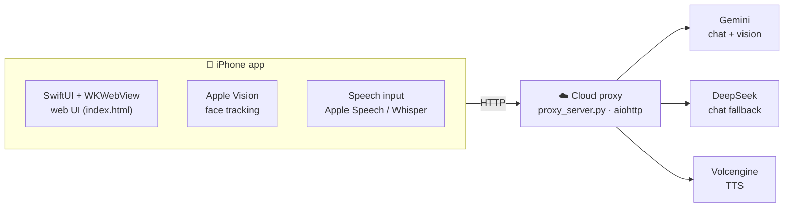

<div align="center">


# AI Makeup Assistant

**An iOS makeup coach. "Xiaomei" watches your face through the camera,<br/>teaches you step by step, and speaks up when you go off the line.**

[](#quick-start)
[](AIMakeupAssistant/ContentView.swift)
[](proxy_server.py)
[](LICENSE)

English · [简体中文](README.zh-CN.md)

</div>

## Features

| | Feature | What it does |
|:-:|---|---|
| 💄 | **Step-by-step lessons** | Ask Xiaomei for a look; it is split into 3–6 steps and each step is checked automatically |
| ⚠️ | **Off-the-line alerts** | If lipstick goes outside the lip line, the area is circled with a red dashed line and Xiaomei tells you out loud |
| 📸 | **Live face tracking** | Native Apple Vision tracks lips, eyebrows and face outline at 5 fps |
| 🗣️ | **Natural voice** | Volcengine Doubao TTS 2.0 with the "Mao Xiaomei" neural voice, streamed sentence by sentence |
| 📞 | **Voice call mode** | Speech recognition + AI reply + TTS that speaks while it generates, like a phone call |
| 💬 | **Text & voice chat** | Gemini as primary, DeepSeek as automatic fallback, so rate limits never stop a conversation |
| ♿ | **Accessibility** | VoiceOver, aria-live, earcons, high-contrast text and reduced motion |
| 🏪 | **Nearby stores** | GPS location + cosmetics store recommendations |

## How it works



> [!TIP]
> The iOS app **never talks to** Google, DeepSeek or Volcengine directly. All API keys live in the proxy's `.env`, which is git-ignored, so **nothing leaks through git**.

## Quick start

Requires macOS 14+ and Xcode 15+. Test on a real iPhone — the simulator has no camera.

1. Open `AIMakeupAssistant.xcodeproj`
2. Select your iPhone as the run destination
3. Press <kbd>⌘</kbd> <kbd>R</kbd>

The app needs a running cloud proxy. To use your own, deploy it as below and set `proxyHost` at the top of `AIMakeupAssistant/ContentView.swift`.

## Deploy the cloud proxy

The server must be in a **region where Gemini is available** (Singapore, Tokyo, Seoul, Europe, US). Hong Kong and mainland China IPs are rejected by Google. An Alibaba Cloud Simple Application Server (1 vCPU / 1 GB / 30 Mbps) costs about ¥24/month.

<details>
<summary><b>Step-by-step server setup</b></summary>

**1. SSH in and install**

```bash
apt update -y && apt install -y python3-pip python3-venv
mkdir -p /opt/proxy && cd /opt/proxy
python3 -m venv venv
./venv/bin/pip install aiohttp
```

**2. Upload `proxy_server.py`** (run on your Mac)

```bash
scp proxy_server.py root@YOUR_SERVER_IP:/opt/proxy/
```

**3. Write `.env`** (on the server)

```bash
cat > /opt/proxy/.env <<'EOF'
GEMINI_API_KEY=...
GEMINI_MODEL=gemini-2.5-flash-lite
DEEPSEEK_API_KEY=sk-...
VOLC_TTS_APP_ID=...
VOLC_TTS_ACCESS_TOKEN=...
VOLC_TTS_RESOURCE_ID=volc.service_type.10029
VOLC_TTS_VOICE=zh_female_cancan_mars_bigtts
PORT=8888
EOF
chmod 600 /opt/proxy/.env
```

**4. Create the systemd service**

```bash
cat > /etc/systemd/system/ai-proxy.service <<'EOF'
[Unit]
Description=AI Makeup Assistant Proxy
After=network.target

[Service]
Type=simple
WorkingDirectory=/opt/proxy
EnvironmentFile=/opt/proxy/.env
ExecStart=/opt/proxy/venv/bin/python -u /opt/proxy/proxy_server.py
Restart=on-failure
RestartSec=3
User=root

[Install]
WantedBy=multi-user.target
EOF

systemctl daemon-reload
systemctl enable ai-proxy
systemctl start ai-proxy
```

**5. Open TCP port 8888** in your cloud console's firewall (TCP / 8888 / `0.0.0.0/0`).

**6. Verify** — a 200 response with an AI reply means you're done.

```bash
curl http://YOUR_SERVER_IP:8888/health
curl -X POST http://YOUR_SERVER_IP:8888/api/chat \
  -H "Content-Type: application/json" \
  -d '{"contents":[{"role":"user","parts":[{"text":"Hello"}]}]}'
```

**7. Point the iOS app at your server** — at the top of `AIMakeupAssistant/ContentView.swift`, then press <kbd>⌘</kbd> <kbd>R</kbd> to reinstall:

```swift
private static let proxyHost = "YOUR_SERVER_IP:8888"
```

</details>

<details>
<summary><b>Maintenance commands</b></summary>

```bash
# Follow proxy logs
ssh root@YOUR_SERVER_IP 'journalctl -u ai-proxy -f'

# Redeploy after editing proxy_server.py
scp proxy_server.py root@YOUR_SERVER_IP:/opt/proxy/
ssh root@YOUR_SERVER_IP 'systemctl restart ai-proxy'

# Change environment variables
ssh root@YOUR_SERVER_IP 'nano /opt/proxy/.env && systemctl restart ai-proxy'
```

</details>

### Proxy API

| Path | Method | Purpose |
|---|:-:|---|
| `/health` | `GET` | Health check |
| `/api/chat` | `POST` | Gemini text chat (with automatic DeepSeek fallback) |
| `/api/tts` | `POST` | Volcengine Doubao TTS (returns MP3) |
| `/api/tts-gemini` | `POST` | Gemini TTS backup |
| `/api/live` | `WS` | Gemini Live WebSocket relay (not used by the iOS app right now) |

### Where to get credentials

| Service | Sign-up | Price |
|---|---|---|
| Gemini API | [aistudio.google.com](https://aistudio.google.com/apikey) | Free tier, ~1,000 requests/day |
| DeepSeek API | [platform.deepseek.com](https://platform.deepseek.com/) | A ¥10 top-up lasts a long time |
| Volcengine Doubao TTS | [console.volcengine.com](https://console.volcengine.com/speech/service/8) | 100k characters/month free |
| Alibaba Cloud server | [swas.console.aliyun.com](https://swas.console.aliyun.com/#/buy) | ¥24/month (Singapore) |

## TestFlight

Requires the Apple Developer Program ($99/year). See [TESTFLIGHT.md](TESTFLIGHT.md) for the step-by-step guide (in Chinese).

## Project structure

```
AIMakeupAssistant/                 (repo root)
├── AIMakeupAssistant/             iOS source
│   ├── ContentView.swift          Entry view, AI/TTS/STT managers, WebView bridge
│   ├── AIMakeupAssistantApp.swift App entry point
│   ├── index.html                 The whole web UI (~4,500 lines)
│   ├── Info.plist                 Permission descriptions
│   └── Assets.xcassets/           App icon (lipstick theme)
├── AIMakeupAssistant.xcodeproj/   Xcode project
├── proxy_server.py                Cloud proxy (copy of what runs on the server)
├── .env.example                   Config template (.env itself is git-ignored)
├── TESTFLIGHT.md                  TestFlight release guide (Chinese)
├── README.md                      This file
└── README.zh-CN.md                Chinese README
```

## Tech stack

| Layer | Technology |
|---|---|
| iOS native | Swift, SwiftUI, WKWebView, AVFoundation, Vision, CoreLocation |
| Web UI | Plain HTML + CSS + JS (no framework) |
| Proxy | Python 3.12 + aiohttp |
| Deployment | Ubuntu 24.04 + systemd |
| AI | Gemini 2.5 Flash Lite / DeepSeek Chat |
| TTS | Volcengine Doubao speech synthesis 2.0 |
| STT | SiliconFlow Whisper (default) / Apple Speech Recognition (fallback) |
| Face detection | Apple Vision Framework |

## License

[MIT](LICENSE)
