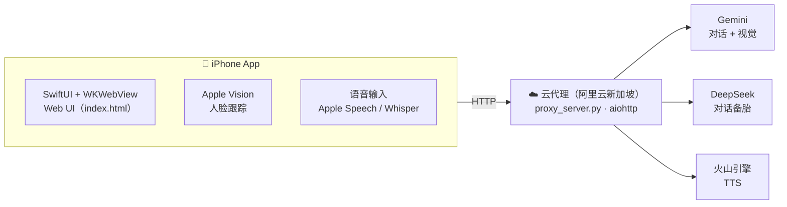

<div align="center">


# AI 美妆助手

**一款 iOS 美妆教练 App。「小美」通过摄像头实时观察你的脸，<br/>一步步教你化妆，化偏了会提醒你。**

[](#快速开始)
[](AIMakeupAssistant/ContentView.swift)
[](proxy_server.py)
[](LICENSE)

[English](README.md) · 简体中文

</div>

## 功能

| | 功能 | 说明 |
|:-:|---|---|
| 💄 | **化妆任务清单** | 让小美教你化妆，自动拆成 3-6 步，每步自动检测完成度 |
| ⚠️ | **画偏检测** | 涂口红时如果画到唇线外，红色虚线圈出 + 小美开口提醒 |
| 📸 | **人脸实时检测** | Apple Vision 原生，5 fps 跟踪嘴唇 / 眉毛 / 脸框 |
| 🗣️ | **AI 语音播报** | 火山豆包 TTS 2.0，「猫小美」端到端神经语音，流式逐句播报 |
| 📞 | **语音通话模式** | STT 识别 + AI 回复 + TTS 边出边说，像打电话一样 |
| 💬 | **文字 / 语音对话** | Gemini 主，DeepSeek 自动备胎，永远不撞限速 |
| ♿ | **完整无障碍** | VoiceOver / aria-live / earcon / 高对比度文字 / 减弱动画 |
| 🏪 | **附近店铺** | GPS 定位 + 化妆品店推荐 |

## 整体架构



> [!TIP]
> iOS **不直接接触** Google / DeepSeek / 火山，所有 API key 都在云代理的 `.env` 里（已 .gitignore），**进 git 不会泄露**。

## 快速开始

需要 macOS 14+、Xcode 15+。测试用真机，模拟器没有摄像头。

1. 打开 `AIMakeupAssistant.xcodeproj`
2. 选你的 iPhone 作为设备目标
3. 按 <kbd>⌘</kbd> <kbd>R</kbd> 运行

## 部署云代理

> [!NOTE]
> 已经部署在阿里云新加坡轻量服务器 `47.236.78.87:8888`，systemd 守护，开机自启。下面的步骤给你**以后换服务器 / 新搭一台**用。

服务器地域必须在 **Gemini 支持区**（新加坡、东京、首尔、欧美），香港 / 大陆 IP 会被 Google 拒绝。阿里云轻量（1 核 1G 30M）约 ¥24/月起。

<details>
<summary><b>分步部署教程</b></summary>

**1. SSH 上去装环境**

```bash
apt update -y && apt install -y python3-pip python3-venv
mkdir -p /opt/proxy && cd /opt/proxy
python3 -m venv venv
./venv/bin/pip install aiohttp
```

**2. 上传 `proxy_server.py`**（在 Mac 本地执行）

```bash
scp proxy_server.py root@你的IP:/opt/proxy/
```

**3. 写 `.env`**（在服务器上）

```bash
cat > /opt/proxy/.env <<'EOF'
GEMINI_API_KEY=...
GEMINI_MODEL=gemini-2.5-flash-lite
DEEPSEEK_API_KEY=sk-...
VOLC_TTS_APP_ID=...
VOLC_TTS_ACCESS_TOKEN=...
VOLC_TTS_RESOURCE_ID=volc.service_type.10029
VOLC_TTS_VOICE=zh_female_cancan_mars_bigtts
PORT=8888
EOF
chmod 600 /opt/proxy/.env
```

**4. 配置 systemd 服务**

```bash
cat > /etc/systemd/system/ai-proxy.service <<'EOF'
[Unit]
Description=AI Makeup Assistant Proxy
After=network.target

[Service]
Type=simple
WorkingDirectory=/opt/proxy
EnvironmentFile=/opt/proxy/.env
ExecStart=/opt/proxy/venv/bin/python -u /opt/proxy/proxy_server.py
Restart=on-failure
RestartSec=3
User=root

[Install]
WantedBy=multi-user.target
EOF

systemctl daemon-reload
systemctl enable ai-proxy
systemctl start ai-proxy
```

**5. 防火墙开 8888 TCP**：阿里云控制台 → 防火墙 → 添加规则 → TCP / 8888 / `0.0.0.0/0`

**6. 验证**：返回 200 + AI 回复 = 完成。

```bash
curl http://你的IP:8888/health
curl -X POST http://你的IP:8888/api/chat \
  -H "Content-Type: application/json" \
  -d '{"contents":[{"role":"user","parts":[{"text":"你好"}]}]}'
```

**7. 改 iOS 用新 IP**：改 `AIMakeupAssistant/ContentView.swift` 顶部，然后 <kbd>⌘</kbd> <kbd>R</kbd> 重装到 iPhone。

```swift
private static let proxyHost = "47.236.78.87:8888"  // ← 换成新 IP
```

</details>

<details>
<summary><b>日常维护命令</b></summary>

```bash
# 看代理日志
ssh root@47.236.78.87 'journalctl -u ai-proxy -f'

# 改了 proxy_server.py 重新部署
scp proxy_server.py root@47.236.78.87:/opt/proxy/
ssh root@47.236.78.87 'systemctl restart ai-proxy'

# 改环境变量
ssh root@47.236.78.87 'nano /opt/proxy/.env && systemctl restart ai-proxy'
```

</details>

### 代理 API 端点

| 路径 | 方法 | 用途 |
|---|:-:|---|
| `/health` | `GET` | 状态检查 |
| `/api/chat` | `POST` | Gemini 文字对话（带 DeepSeek 自动 fallback） |
| `/api/tts` | `POST` | 火山豆包 TTS（返回 MP3） |
| `/api/tts-gemini` | `POST` | Gemini TTS 备用 |
| `/api/live` | `WS` | Gemini Live WebSocket 转发（当前 iOS 未使用） |

### 凭证去哪里办

| 服务 | 申请入口 | 价格 |
|---|---|---|
| Gemini API | [aistudio.google.com](https://aistudio.google.com/apikey) | 免费档 ~1000 请求/天 |
| DeepSeek API | [platform.deepseek.com](https://platform.deepseek.com/) | 充值 ¥10 可用很久 |
| 火山豆包 TTS | [console.volcengine.com](https://console.volcengine.com/speech/service/8) | 免费 10 万字符/月 |
| 阿里云轻量服务器 | [swas.console.aliyun.com](https://swas.console.aliyun.com/#/buy) | ¥24/月（新加坡） |

## TestFlight 发布

需要 Apple Developer Program（¥688/年），详细步骤见 [TESTFLIGHT.md](TESTFLIGHT.md)。

## 项目结构

```
AIMakeupAssistant/                 仓库根目录
├── AIMakeupAssistant/             iOS 源码
│   ├── ContentView.swift          主入口、AI/TTS/STT 管理器、WebView 桥接
│   ├── AIMakeupAssistantApp.swift App 入口
│   ├── index.html                 整个 Web UI（~4500 行）
│   ├── Info.plist                 权限描述
│   └── Assets.xcassets/           App 图标（口红主题）
├── AIMakeupAssistant.xcodeproj/   Xcode 项目
├── proxy_server.py                云代理服务（部署到阿里云的副本）
├── .env.example                   配置模板（.env 本身不进 git）
├── TESTFLIGHT.md                  TestFlight 发布手册
├── README.md                      英文说明
└── README.zh-CN.md                本文件
```

## 技术栈

| 层 | 技术 |
|---|---|
| iOS 原生 | Swift, SwiftUI, WKWebView, AVFoundation, Vision, CoreLocation |
| Web UI | 纯 HTML + CSS + JS（无框架） |
| 代理 | Python 3.12 + aiohttp |
| 部署 | Ubuntu 24.04 + systemd |
| AI | Gemini 2.5 Flash Lite / DeepSeek Chat |
| TTS | 火山豆包语音合成大模型 2.0 |
| STT | SiliconFlow Whisper（默认）/ Apple Speech Recognition（兜底） |
| 人脸检测 | Apple Vision Framework |

## License

[MIT](LICENSE)
